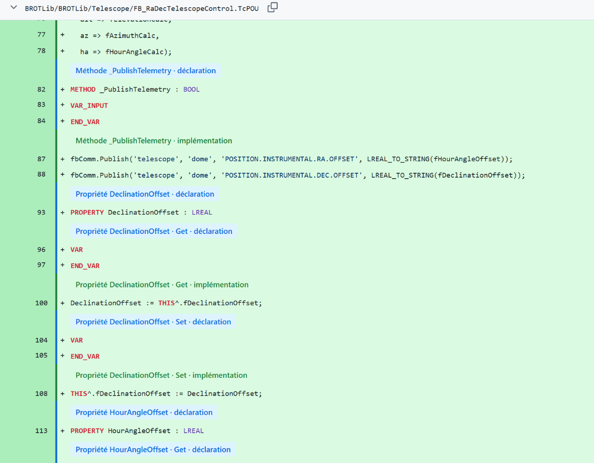
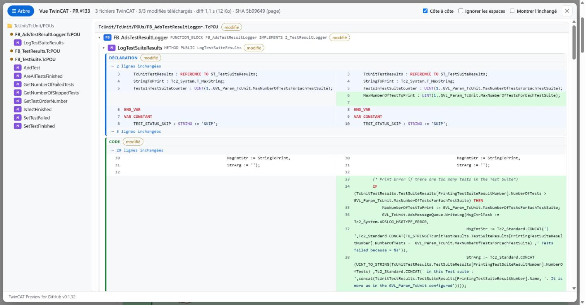
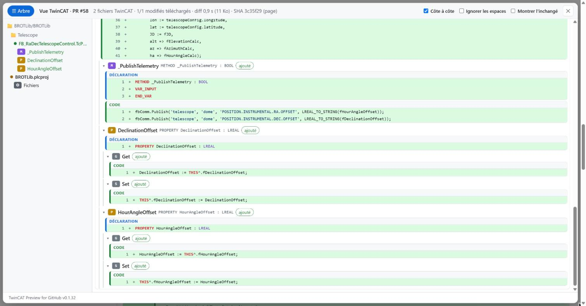
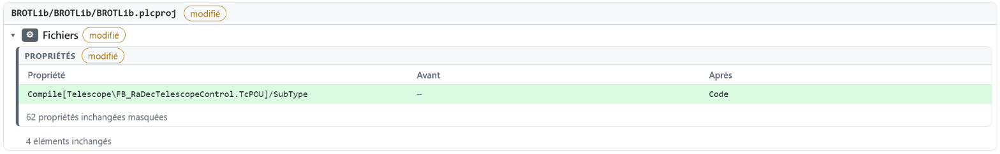
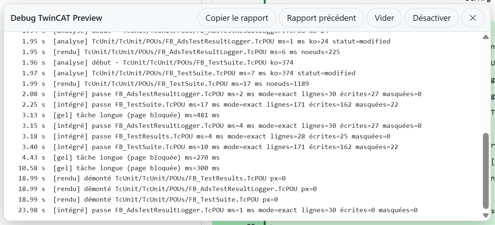

# TwinCAT Preview for GitHub

[English](README.md) · **Français**

Extension Chrome / Edge qui rend lisibles les pull requests **TwinCAT 3** sur GitHub : du code ST au lieu du XML, organisé comme dans TwinCAT, avec des commentaires de revue qui continuent de fonctionner.

> Projet non officiel, sans lien avec Beckhoff Automation. TwinCAT est une marque de Beckhoff Automation GmbH.

| Sans l'extension | Avec l'extension |
|---|---|
|  |  |

> **Vous utilisez Azure DevOps plutôt que GitHub ?** Regardez [TcPreview](https://marketplace.visualstudio.com/items?itemName=dfreiberger.tc-preview-extension) de dfreiberger, une extension gratuite qui affiche les fichiers TwinCAT (`.TcPOU`, `.TcDUT`, `.TcGVL`, `.TcIO`) dans Azure Repos et les pull requests ([code source](https://github.com/dfreiberger/tc-preview-extension)). Elle a inspiré ce projet.

---

## Installation

1. Télécharger ce dépôt : bouton vert **Code** > **Download ZIP**, puis décompresser (ou `git clone`).
2. Ouvrir `chrome://extensions` (Edge : `edge://extensions`) et activer le **mode développeur** (en haut à droite).
3. Cliquer sur **Charger l'extension non empaquetée** et choisir le dossier décompressé (celui qui contient `manifest.json`).
4. Recharger les onglets GitHub déjà ouverts.

Mise à jour : remplacer le contenu du dossier, cliquer sur ⟳ dans la carte de l'extension sur `chrome://extensions`, puis recharger GitHub.

## Utilisation

### 1. La barre d'outils

Ouvrir n'importe quelle pull request sur github.com. Une barre apparaît en bas à droite :


| Bouton | Rôle |
|---|---|
| **TwinCAT : intégré** | Met en forme les fichiers TwinCAT directement dans le diff de GitHub. Un nouveau clic rend le XML brut. Réglage mémorisé d'une PR à l'autre. L'icône de l'extension fait la même chose. |
| **Panneau** | Ouvre la vue d'ensemble de toute la PR. Raccourci : `Alt+T`. |
| **🐞** | Mode debug : montre où part le temps de chargement. |

### 2. Relire dans le diff de GitHub (onglet « Files changed »)

Activer **TwinCAT : intégré** et relire comme d'habitude dans l'onglet **Files changed** :


- La structure XML (`<Implementation>`, `]]></Declaration>`, `<Method Name=…>`) et le bruit (`LineIds`, GUID, version XAE) sont masqués.
- Le code ST s'affiche sans `<![CDATA[`, coloré.
- Chaque section commence par un bandeau : **bleu** pour une déclaration, **vert** pour du code (ex. « Propriété DeclinationOffset · Get · implémentation »).
- **Les commentaires fonctionnent exactement comme avant** : le bouton « + », les numéros de ligne et les fils existants sont ceux de GitHub. Un commentaire est posé sur la vraie ligne du fichier, et un collègue sans l'extension le voit au même endroit.

Concerne les objets PLC (`.TcPOU`, `.TcDUT`, `.TcGVL`, `.TcIO`).

### 3. Comprendre toute la PR (Panneau)

Cliquer sur **Panneau** (ou `Alt+T`) pour une vue d'ensemble de tous les fichiers TwinCAT de la PR.

**Côte à côte** : avant à gauche, après à droite, méthode par méthode.



**Arborescence TwinCAT** : un bloc par objet (FB > méthodes / propriétés > Get / Set), avec sa signature. L'arbre de gauche permet de sauter à n'importe quel membre.



**Fichiers de configuration** (`.plcproj`, `.tsproj`, `.xti`, `.TcTTO`) : présentés en tableaux de propriétés, avec seulement ce qui a changé.



Options du panneau (en haut à droite) :

| Option | Usage |
|---|---|
| **☰ Arbre** | Masquer l'arborescence pour donner toute la largeur au code. |
| **Côte à côte** | Avant / après sur deux colonnes (décocher pour une seule colonne). |
| **Ignorer les espaces** | Masquer les changements de mise en forme pure (ex. après TcBlack). |
| **Montrer l'inchangé** | Afficher aussi les sections et propriétés identiques. |

Les grosses PR passent sans problème : un fichier n'est chargé qu'à l'approche de l'écran, et une seule fois.

### 4. C'est lent ? (mode debug)

Cliquer sur **🐞** pour voir en direct chaque étape (réseau, analyse, rendu). **Copier le rapport** met une synthèse dans le presse-papiers, prête à coller dans une issue. Le rapport contient les chemins des fichiers, jamais leur contenu.



## Langue

L'interface suit la langue du navigateur : français si elle est en français, anglais sinon. Pour forcer une langue, exécuter `localStorage.setItem("tcpr-lang", "fr")` (ou `"en"`) dans la console d'une page github.com, puis recharger.

## Confidentialité

Tout se passe dans le navigateur. L'extension ne communique qu'avec GitHub, avec la session GitHub déjà ouverte (les dépôts privés fonctionnent, sans token). Aucune télémétrie, aucun serveur. Détails dans [PRIVACY.fr.md](PRIVACY.fr.md).

## Plus de documentation

- [Guide d'utilisation](docs/GUIDE.fr.md) : toutes les options, dépannage.
- [Architecture](docs/ARCHITECTURE.fr.md) : fonctionnement, pour contribuer.
- [Confidentialité](PRIVACY.fr.md) : ce qui est lu, stocké, et jamais envoyé.

## Développement

```bash
node test/run.js
```

```bash
node test/harness/serve.mjs
```

puis ouvrir http://localhost:8787/test/harness/ (panneau), `/test/harness/inline.html` (mise en forme intégrée) et `/test/harness/stress.html` (test de charge).

## Crédits et licence

Inspiré de TcCompare (Beckhoff) et de [TcPreview](https://github.com/dfreiberger/tc-preview-extension) (aperçu TwinCAT pour Azure DevOps, [Marketplace](https://marketplace.visualstudio.com/items?itemName=dfreiberger.tc-preview-extension)). Les fichiers de test de `test/fixtures` viennent de [TcBlack](https://github.com/Roald87/TcBlack) (MIT, voir [test/fixtures/LICENSE-TcBlack](test/fixtures/LICENSE-TcBlack)). Captures réalisées sur des pull requests publiques de [TcUnit](https://github.com/tcunit/TcUnit) et [BROTLib](https://github.com/BROTLib).

Licence : [MIT](LICENSE).

## Limites connues

- Mise en forme intégrée : nouvelle vue « Files changed » de GitHub uniquement, objets PLC uniquement.
- `.tsproj` : vue générique en propriétés, pas encore de vue dédiée des liens I/O ou de la topologie EtherCAT.
- github.com uniquement (pas GitHub Enterprise Server).
