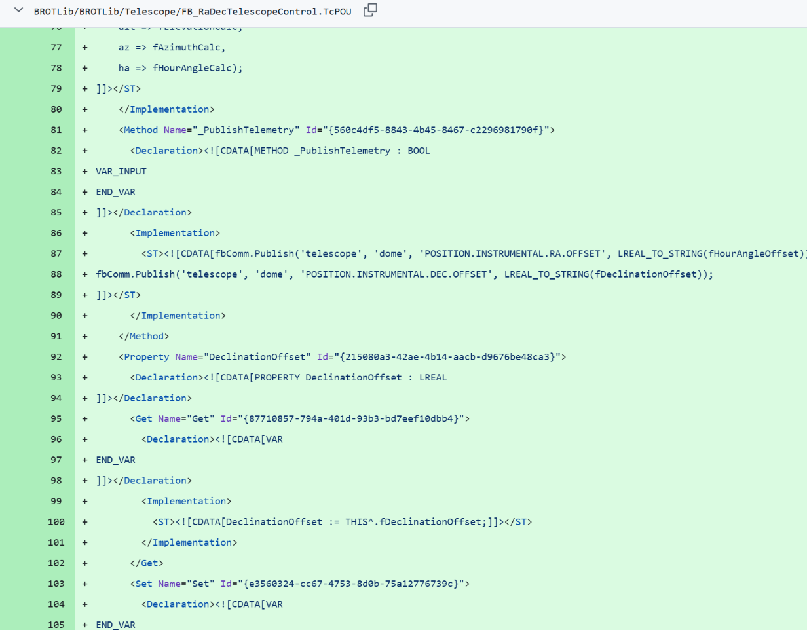
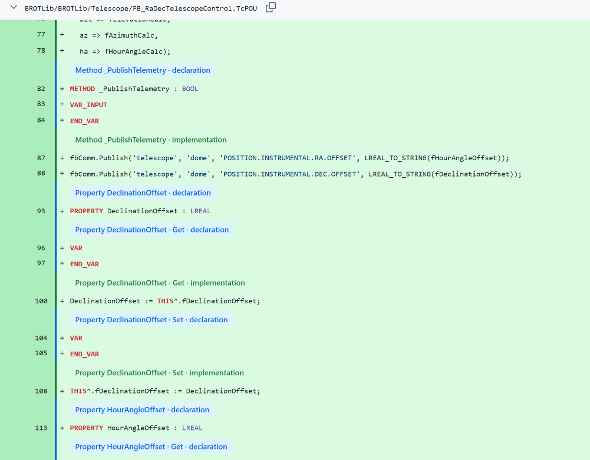
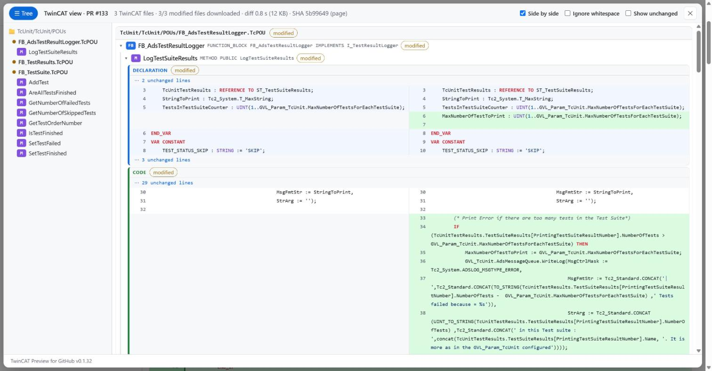
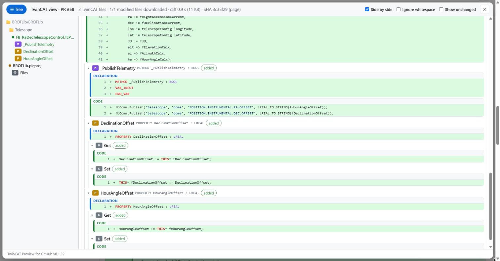
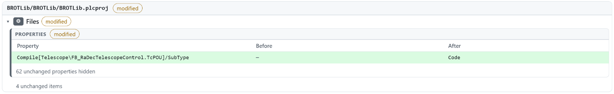
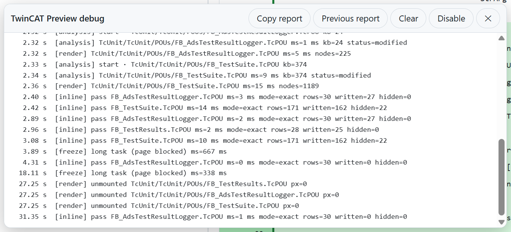

# TwinCAT Preview for GitHub

**English** · [Français](README.fr.md)

A Chrome / Edge extension that makes **TwinCAT 3** pull requests readable on GitHub: ST code instead of XML, organized like in TwinCAT, while review comments keep working.

> Unofficial project, not affiliated with Beckhoff Automation. TwinCAT is a trademark of Beckhoff Automation GmbH.

| Without the extension | With the extension |
|---|---|
|  |  |

---

## Installation

1. Download this repository: green **Code** button > **Download ZIP**, then extract it (or `git clone` it).
2. Open `chrome://extensions` (Edge: `edge://extensions`) and turn on **Developer mode** (top right).
3. Click **Load unpacked** and select the extracted folder (the one containing `manifest.json`).
4. Reload the GitHub tabs that were already open.

To update: replace the folder content, click ⟳ on the extension card in `chrome://extensions`, then reload GitHub.

## How to use it

### 1. The toolbar

Open any pull request on github.com. A toolbar appears at the bottom right:


| Button | What it does |
|---|---|
| **TwinCAT: inline** | Formats TwinCAT files directly inside GitHub's diff. Click again to get the raw XML back. Remembered across PRs. The extension icon does the same. |
| **Panel** | Opens the overview of the whole PR. Shortcut: `Alt+T`. |
| **🐞** | Debug mode: shows where loading time goes. |

### 2. Review in GitHub's diff ("Files changed" tab)

Turn on **TwinCAT: inline** and review as usual in the **Files changed** tab:


- XML structure (`<Implementation>`, `]]></Declaration>`, `<Method Name=…>`) and noise (`LineIds`, GUIDs, XAE version) are hidden.
- ST code is shown without `<![CDATA[`, with syntax highlighting.
- Each section starts with a banner: **blue** for a declaration, **green** for code (e.g. "Property DeclinationOffset · Get · implementation").
- **Comments work exactly as before**: the "+" button, line numbers and existing threads are GitHub's own. A comment lands on the real line of the file, so colleagues without the extension see it at the same place.

Works on PLC objects (`.TcPOU`, `.TcDUT`, `.TcGVL`, `.TcIO`).

### 3. Understand the whole PR (Panel)

Click **Panel** (or `Alt+T`) for an overview of every TwinCAT file of the PR.

**Side by side**: before on the left, after on the right, method by method.



**TwinCAT tree**: one block per object (FB > methods / properties > Get / Set), with its signature. The tree on the left lets you jump to any member.



**Configuration files** (`.plcproj`, `.tsproj`, `.xti`, `.TcTTO`) become property tables: only what changed is shown.



Panel options (top right):

| Option | Use |
|---|---|
| **☰ Tree** | Hide the tree to give the code the full width. |
| **Side by side** | Before / after in two columns (uncheck for a single column). |
| **Ignore whitespace** | Hide pure formatting changes (e.g. after running TcBlack). |
| **Show unchanged** | Also show identical sections and properties. |

Large PRs are fine: files are loaded only when they get close to the screen, and only once.

### 4. Something is slow? (debug mode)

Click **🐞** to see a live log of every step (network, analysis, rendering). **Copy report** puts a summary in the clipboard, ready to paste into an issue. The report contains file paths, never file contents.



## Language

The interface follows your browser language: French if it is French, English otherwise. To force a language, run `localStorage.setItem("tcpr-lang", "en")` (or `"fr"`) in the console of a github.com page, then reload.

## Privacy

Everything runs in your browser. The extension only talks to GitHub, with your existing GitHub session (private repositories work, no token needed). No telemetry, no server. Details in [PRIVACY.md](PRIVACY.md).

## More documentation

- [User guide](docs/GUIDE.md): every option, troubleshooting.
- [Architecture](docs/ARCHITECTURE.md): how it works, for contributors.
- [Privacy](PRIVACY.md): what is read, stored, and never sent.

## Development

```bash
node test/run.js
```

```bash
node test/harness/serve.mjs
```

then open http://localhost:8787/test/harness/ (panel), `/test/harness/inline.html` (inline formatting) and `/test/harness/stress.html` (load test).

## Credits and license

Inspired by TcCompare (Beckhoff) and [TcPreview](https://github.com/dfreiberger/tc-preview-extension) (TwinCAT preview for Azure DevOps). Test files in `test/fixtures` come from [TcBlack](https://github.com/Roald87/TcBlack) (MIT, see [test/fixtures/LICENSE-TcBlack](test/fixtures/LICENSE-TcBlack)). Screenshots were taken on public pull requests of [TcUnit](https://github.com/tcunit/TcUnit) and [BROTLib](https://github.com/BROTLib).

License: [MIT](LICENSE).

## Known limitations

- Inline formatting: GitHub's new "Files changed" view only, PLC objects only.
- `.tsproj`: generic property view, no dedicated view of I/O links or EtherCAT topology yet.
- github.com only (no GitHub Enterprise Server).
